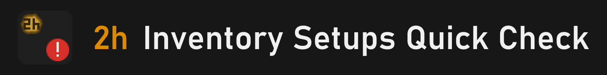

- Click the red ! at the bank: see what's missing from your Inventory Setups setup. 
- Bank items show how many to take out; low potions are outlined.

## What it shows

- **The button.** A red "!" on the attack tab while your bank is open.
- **Missing.** A small box beside the button with each missing item's picture and how many you need. It updates as you withdraw.
- **Bank numbers.** An orange number on each bank item you need: how many to take out.
- **Low potions.** Potions below your setup's dose are outlined in your inventory.
- **All good.** When nothing is missing, "All good" shows above the button.

## Quick guide

1. **Pick a setup.** In the Inventory Setups plugin, click View setup (bank filter on).
2. **Open your bank** and **click the red !** on the attack tab.
3. **Withdraw** the numbered items. The box shrinks as you go.
4. **Close the bank.** The box, numbers and outlines go away.
5. **Hotkey.** Set one in the settings to check anywhere.

## Good to know

- **Needs Inventory Setups.** Without it, or with no setup open, the button tells you what to do.
- **Order doesn't matter.** It checks that each item is there, not which slot it is in. Extra items are ignored.
- **Stackables.** Coins, runes and ammo count once you carry some.
- **Move it.** Hold Alt and drag the button or the box. Alt+right-click puts it back.
- **Settings.** Shift+right-click the ! for Configure and our Discord.
- **Privacy.** No network requests and no files. It only reads your inventory, worn items, bank and the setup.

---

<strong>Found a bug or have an idea?</strong> Join the <a href="https://discord.gg/nsam4CfWzf">2hBuilds Discord</a>.

An add-on for the Inventory Setups plugin, not made by its author. Every check and setting: <a href="https://github.com/2hBuilds/inventory-quick-check/blob/main/DETAILS.md">full details</a>.
