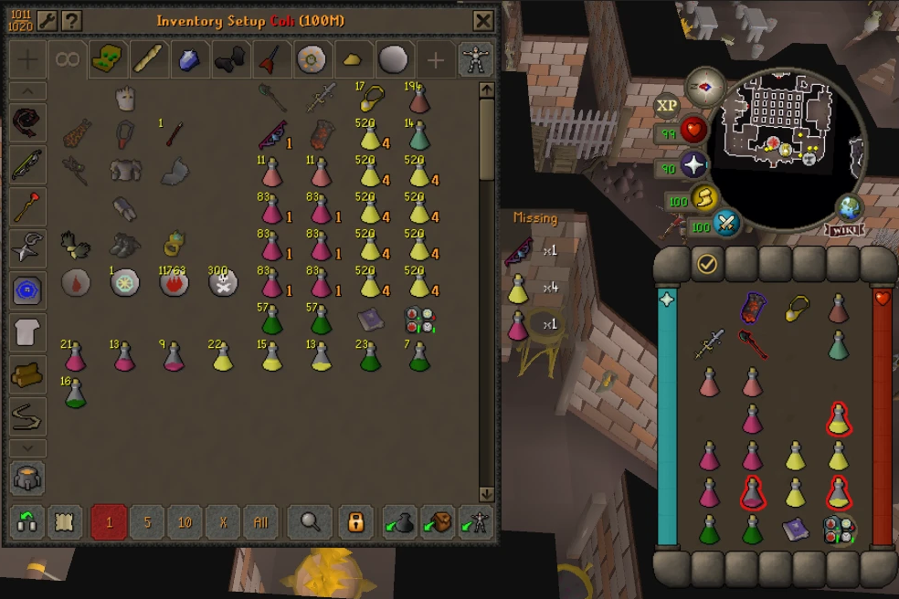
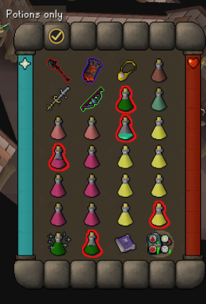

- Click the button at the bank: see what's missing from your Inventory Setups setup. 
- Bank items show how many to take out; low potions are outlined.

## What it shows

- **The button.** Above your inventory while the bank is open.
- **Missing.** A box with each missing item and its count. Updates as you withdraw.
- **Bank numbers.** How many to take out, on each bank item you need.
- **Low potions.** Outlined: below your setup's dose, or not full if the setup doesn't list them.
- **All good.** Shows above the button when nothing is missing.

## Quick guide

1. **Pick a setup.** In the Inventory Setups plugin, click View setup (bank filter on).
2. **Open your bank** and **click the button**.
3. **Withdraw** the numbered items. The box shrinks as you go.
4. **Close the bank.** The box, numbers and outlines go away.
5. **Hotkey.** Set one in the settings to check anywhere.

<table width="100%">
<tr>
<td valign="top">

## No setup? Potions only

With no setup open, one click still outlines every potion that isn't full. Hover the button for how to get the full check.

## Good to know

- **Any order.** Slots don't matter; extra items are ignored.
- **Stackables.** Coins, runes and ammo count once you carry some.
- **Button.** Above the inventory, on the first slot, or on the attack tab; 13 looks, pictured in the settings.
- **Missing box.** Right of the bank, left of the inventory, hidden, or Alt+drag it anywhere (Alt+right-click puts it back).
- **Shift+right-click the button** for Configure, Outline colour (recolours potions live) and our Discord.
- **Privacy.** No network, no files; it only reads your items, bank and setup.

</td>
<td width="28"></td>
<td align="right" valign="top" width="235">

 

</td>
</tr>
</table>

---

<strong>Found a bug or have an idea?</strong> Join the <a href="https://discord.gg/nsam4CfWzf">2hBuilds Discord</a>.

An add-on for the Inventory Setups plugin, not made by its author. Every check and setting: <a href="https://github.com/2hBuilds/inventory-quick-check/blob/main/DETAILS.md">full details</a>.
